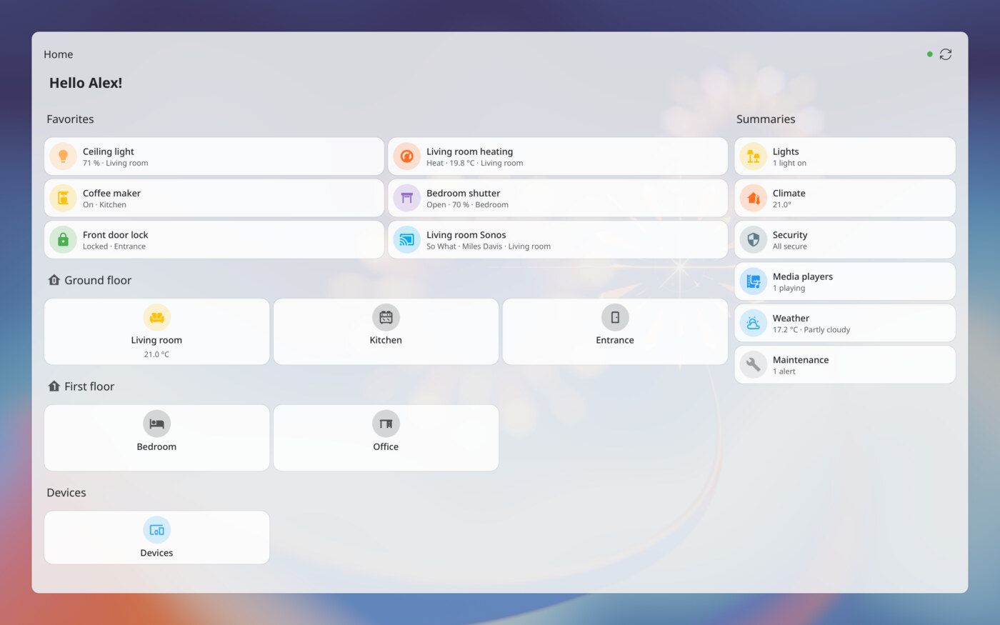
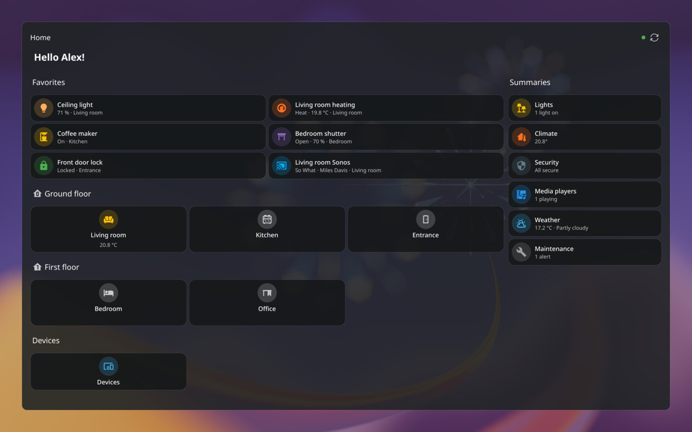

# Home Assistant Dashboard — widget Plasma 6

*[English version](README.md)*

| Thème clair | Thème sombre |
|---|---|
|  |  |

Affiche un tableau de bord Home Assistant sur le bureau KDE Plasma, avec ses cartes
redessinées en QML natif : thème Plasma, mises à jour en temps réel, actions au clic.

> **Transparence :** ce widget a été entièrement « vibe-codé » : tout son code a été écrit par
> une IA (Claude, via Claude Code) à partir des instructions de l'auteur. Il a été testé sur une
> vraie instance Home Assistant, mais le code n'a pas été relu ligne par ligne.
> Les [signalements de bugs](https://github.com/pacorayban/ha-plasmoid/issues) sont les bienvenus.

## Prérequis

- KDE Plasma 6
- Le module QML Qt WebSockets : `qt6-websockets` (Arch), `qml6-module-qtwebsockets` (Debian/Ubuntu)
- Une instance Home Assistant et un jeton d'accès longue durée

## Installation

Depuis le KDE Store : clic droit sur le bureau → *Ajouter des composants graphiques…* →
*Obtenir de nouveaux composants graphiques…* → chercher « Home Assistant Dashboard ».

Depuis un fichier `.plasmoid` :

```bash
kpackagetool6 -t Plasma/Applet -i hadashboard-<version>.plasmoid
```

Depuis ce dépôt :

```bash
./install.sh
```

Puis : clic droit sur le bureau → *Ajouter des composants graphiques…* → « Home Assistant Dashboard ».
Clic droit sur le widget → *Configurer* :

- **Adresse** : `http://homeassistant.local:8123` (ou `https://…`)
- **Jeton** : profil HA → onglet *Sécurité* → *Jetons d'accès longue durée*
- **Tableau de bord** : l'adresse copiée depuis le navigateur (`https://…/dashboard-music/0`, la vue
  est reprise) ou juste le chemin (`dashboard-music`). `home` ou `https://…/home/overview` = la page
  *Accueil* de HA. Vide = le tableau de bord par défaut, ou la page *Accueil* s'il n'y en a pas
  (comme le site).

Le jeton est stocké en clair dans `~/.config/plasma-org.kde.plasma.desktop-appletsrc`.

## Ce qui est affiché

- La page *Accueil* (`/home`) est reconstruite comme dans HA : favoris (épinglés + suggestions
  d'usage de HA), pièces par étage (cartes compactes qui ouvrent la sous-vue de la pièce),
  appareils sans pièce, et résumés (lumières, climat, sécurité, médias, météo, maintenance)
  en colonne à droite, ou après les favoris si le widget est étroit. Le résumé « Énergie » n'est
  pas géré.
- Les autres tableaux de bord sont lus via l'API WebSocket (`lovelace/config`). Quand HA les génère
  lui-même (l'« Aperçu » par défaut, ou un tableau de bord à stratégie), le widget les reconstruit :
  une carte par pièce, puis par appareil, puis par domaine.
- Vues : maçonnerie, sections (grille de 12) et panneau ; onglets si plusieurs vues ; badges.
- Cartes prises en charge : `entities`, `entity-filter`, `tile` (+ fonctions luminosité, volet,
  température, modes), `button`, `glance`, `heading`, `sensor`, `entity`, `gauge`, `thermostat`,
  `light`, `markdown` (modèles rendus par HA), `weather-forecast`, `media-control`,
  `picture`, `picture-entity`, `picture-glance`, `history-graph`, `statistics-graph` (via
  l'historique), `area`, `vertical-stack`, `horizontal-stack`, `grid`, `conditional` et `visibility`.
- Cartes personnalisées (`custom:*`, ex. Mushroom) : dessinées comme une tuile si elles ont une
  `entity`, comme une liste si elles ont des `entities`, sinon un emplacement « non prise en charge ».
- Non gérées : `map`, `logbook`, `calendar`, `iframe`, `todo-list`, énergie.
- Les icônes MDI sont téléchargées depuis votre instance HA (`/static/mdi/`), donc identiques au site.
- Langue et format des nombres : ceux de votre profil HA.

## Langue

L'interface du widget suit la langue du profil Home Assistant (comme le site), pas celle du
système : les états et noms envoyés par HA sont déjà dans cette langue. Textes source en anglais,
traduction française dans `package/contents/code/Tr.js` (ajouter une langue = ajouter un
dictionnaire). La page de configuration Plasma, elle, suit la langue du système.

## Publication sur le KDE Store

```bash
./package.sh        # → dist/hadashboard-<version>.plasmoid
test/screenshots.sh # → dist/screenshots/*.png (clair et sombre, données d'exemple)
```

Sur [store.kde.org](https://store.kde.org) : *Add product* → catégorie *Plasma 6 Applets*,
puis téléverser le fichier `.plasmoid`. Texte de présentation prêt dans `STORE.md`.
Penser à augmenter `Version` dans `package/metadata.json` à chaque nouvelle version.

## Développement

```bash
python3 test/mock_ha.py                          # faux HA sur :8765 (jeton « test »)
python3 test/mock_ha.py --port 8766 --no-config  # sans tableau de bord stocké → page Accueil
python3 test/mock_ha.py --port 8767 --lang en    # données d'exemple en anglais
qml6 test/harness.qml                            # le widget dans une fenêtre, hors Plasma
qml6 test/harness.qml -- --VIEW=1 --SHOT=/tmp/v1.png --AUTOQUIT=1
plasmawindowed org.pacorayban.hadashboard        # le widget installé, dans une fenêtre
```

Les avertissements QML arrivent dans `journalctl --user -f`.

Structure :

- `package/contents/ui/HaClient.qml` — connexion WebSocket, états, registres, traductions, icônes
- `package/contents/ui/DashboardView.qml` / `ViewContent.qml` — chargement et mise en page des vues
- `package/contents/ui/CardLoader.qml` — choix du composant pour chaque type de carte
- `package/contents/ui/cards/*.qml` — les cartes
- `package/contents/code/Ha.js` — formats, icônes, couleurs, actions, conditions
- `package/contents/code/Strategy.js` — reconstruction des tableaux de bord générés (Aperçu, Accueil)
- `package/contents/code/Tr.js` — textes de l'interface et traductions

## Licence

MIT, voir [LICENSE](LICENSE).
